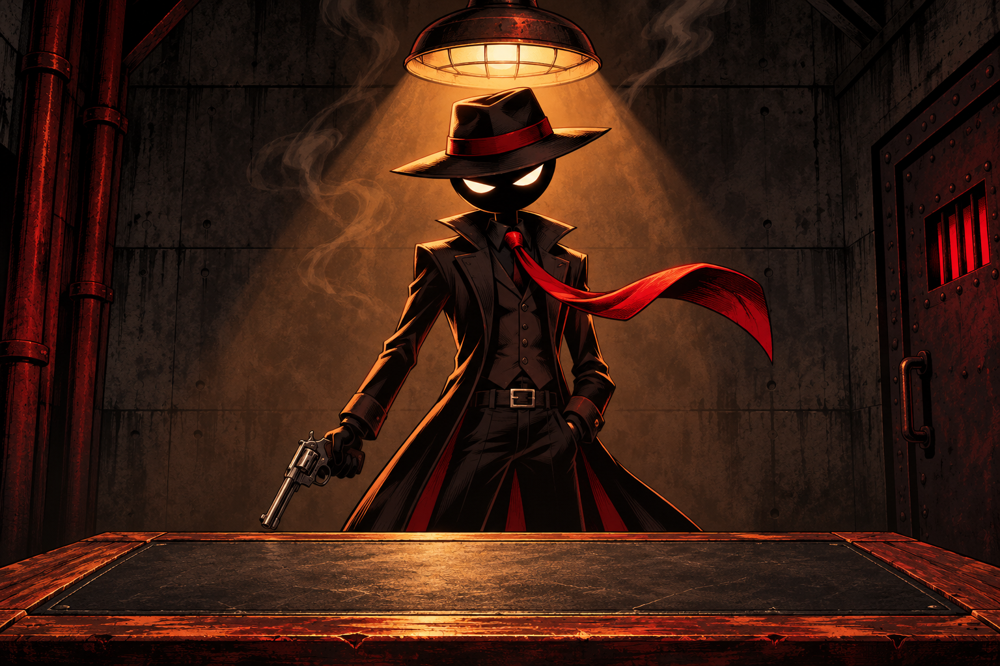

# 终之枪弹 — The Last Shot

<p align="center">
  
</p>

一款类似「波波攒 / 拍拍枪」的高节奏第一人称心理博弈回合制枪战游戏。支持 **PC 端** 与 **手机端** 浏览器直接游玩，现已部署于 GitHub Pages。

- **在线游玩**：[https://GDHJDSYDH.github.io/The-Last-Shot/](https://GDHJDSYDH.github.io/The-Last-Shot/)
- **开源协议**：[CC BY-NC 4.0 International](./LICENSE)（署名-非商业性使用 4.0 国际）

---

## 核心玩法

- **双模式对抗**：
  - **1v1 双人对决**：直面桌面另一端的精致火柴人枪手，展开纯粹的读心博弈。
  - **1v1v1 三人混战**：两名风格迥异的 AI 独立选靶互攻或围攻你，玩家状态栏居中展示，坚持到最后即可胜出。
- **3 秒心理决策（选定即锁定）**：
  - 每回合仅有 **3 秒** 从 **装子弹 / 开火 / 防御** 中做出选择；选定后其余两项立即置灰不可反悔。
  - 电脑端支持快捷按键 `1 / 2 / 3`（或 `Q / W / E`）。
- **3 秒第一人称瞄准开火**：
  - 选择开火后进入 **3 秒瞄准窗口**，第一人称左轮手枪与准星出现，需在 3 秒内瞄准对手点击击发，超时视为弃权进入下一回合。
- **第一人称防暴盾视角**：
  - 选择防御将举起防暴盾近距离挡在面前，透过盾牌上方长方形透明观察口直视对面战况，可完全阻挡普通子弹。
- **六弹蓄满 · 超级射击（Super Shot）**：
  - 每人基础血量 **5 颗心**，普通子弹伤害 **1 颗心**，弹巢上限 **6 发**。
  - 攒满 **6 发子弹** 可触发 **超级射击**：造成 **2 颗心暴击伤害**，**穿透并击碎防暴盾**（令对手下 1 回合禁用防御），压制普通射击，发射后子弹归零。
- **安全防崩溃诊断系统（Crash Guard）**：
  - 内置全局异常拦截与可视化错误报告面板，发生任何运行时异常都不会导致页面直接退出或白屏，方便快速定位问题。

---

## 本地开发

```bash
npm install
npm run dev
```

构建生产静态文件：

```bash
npm run build
```

---

## 许可协议

本项目采用 **[Creative Commons Attribution-NonCommercial 4.0 International (CC BY-NC 4.0)](./LICENSE)** 许可协议。
允许在保留署名且非商业用途的前提下自由分享与改编。
